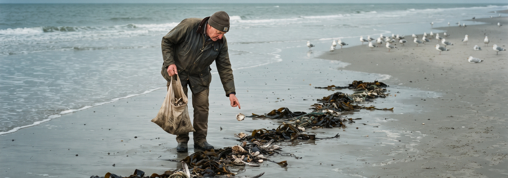
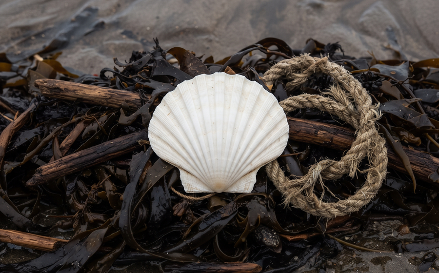

# codeintel-Data-Flow-Analyzer

Lists every line in a Python source file that mentions a sensitive keyword, and runs bandit on the file. - Focused on Tools for static code analysis, vulnerability scanning, and code quality assurance

Matches are unfiltered substring hits, comments included. The tool does not trace data flow and does not identify leaks or injection points. Matched lines are written into the local report in full, so a real secret on a matched line will appear in the report file in full. The report section for these matches is named keyword_lines. If bandit is missing or its output cannot be parsed, the run exits 1 and the JSON report records a bandit_status field naming the failure.

> **Night log margin note: matched lines are written in full.** Matched lines go into the local report in full, under the report section named keyword_lines. A real secret sitting on a matched line will appear in the report file in full.

> **Night log margin note: keyword lines, not data flow.** Matches are unfiltered substring hits, comments included. The tool does not trace data flow and does not identify leaks or injection points.

## Install
`git clone https://github.com/ShadowStrikeHQ/codeintel-data-flow-analyzer`

> **Night log margin note: clone line flagged.** The install line above points to ShadowStrikeHQ, not to ShadowGuard-AI. It is preserved as printed and flagged here, not quietly corrected.

## Usage
`./codeintel-data-flow-analyzer [params]`

> **Night log margin note: usage line flagged.** The usage line above is a placeholder. The parser in main.py requires --source_file and --sensitive_data, and offers --output_file, --log_file, --bandit_severity_threshold, and --bandit_confidence_threshold.

## Parameters
- `-h`: Show help message and exit
- `--source_file`: Path to the Python source file to analyze.
- `--sensitive_data`: No description provided
- `--output_file`: Optional file to write the analysis results to.
- `--log_file`: Optional file to save logs to.
- `--bandit_severity_threshold`: No description provided
- `--bandit_confidence_threshold`: No description provided

## License
Copyright (c) ShadowStrikeHQ

> **Night log margin note: copyright line flagged.** The closing line above reads Copyright (c) ShadowStrikeHQ, preserved as printed. The repository LICENSE file carries the MIT License.
